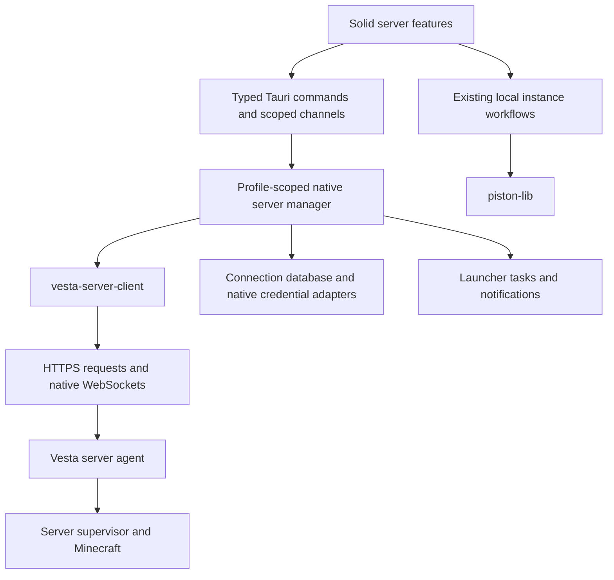

# Launcher Server Backend

Date: 2026-10-21. Architecture and implementation plan, not implemented feature
coverage. Decision: [ADR-0011](../adr/0011-server-client-crate-and-native-host-adapters.md).

## Starting point

The integration starts from the rewritten launcher, without porting the old
`launcher-server-mvp` experiment. Existing launcher functionality stays in its
current modules.

The rewrite's [native entry point](../../apps/desktop-solid/src-tauri/src/main.rs)
selects its profile and calls the existing
[shared host](../../vesta-launcher/src-tauri/src/lib.rs). Its separate Cargo
workspace depends on that host by path. Server integration belongs beneath this
entry point; it does not require moving the entire backend first.

The server contract baseline inspected for this plan is server commit
`28d9ba81c8e598467095776f5dec2c85e06a6646`. Binding server documents are
`docs/operations/management-api-contract.md` sections 2 through 2.2,
`docs/SERVER_SOFTWARE_REQUIREMENTS.md`, and
`docs/SERVER_SOFTWARE_IMPLEMENTATION_PLAN.md`. Runtime routes and fixtures decide
what is implemented when older status summaries disagree. Later draft sections
are not automatically implemented APIs.

## Ownership map

| Area | Owner | Responsibilities |
| --- | --- | --- |
| Remote connection and protocol | New `crates/vesta-server-client` | Endpoint validation, TLS trust, device authentication, request scheduling, reconnects, stream parsing, bounded snapshots, operation reconciliation |
| App integration | `vesta-launcher/src-tauri/src/servers/` | One manager per launcher profile, saved connections, credential-store/signing adapters, tasks, notifications, window subscriptions |
| Native commands | `vesta-launcher/src-tauri/src/commands/servers.rs` | Validate IPC input and delegate; translate bounded domain DTOs/errors |
| Server UI | `apps/desktop-solid/src/features/servers/` | Pairing and trust interaction, keyed reactive snapshots, page subscriptions, localized states |
| Local game work | Existing `piston-lib` and instance modules | Install, update and launch the player's Minecraft instance |
| Server execution | Remote Vesta agent/supervisor | Minecraft files and processes, authoritative permissions, durable operations, backups, sleep and wake policy |



The client does not run Java or contain the server agent. Device storage support
depends on the launcher OS, not on the remote server's OS or CPU architecture.

## Crate and file map

These are planned paths, not existing placeholder implementations:

```text
crates/vesta-server-client/
  src/lib.rs                 Small public client/handle API
  src/model.rs               IDs, snapshots, connection states, typed errors
  src/endpoint.rs            HTTPS endpoints, origin and proxy scope
  src/policy.rs              Limits, timeouts, retry and activity policies
  src/trust.rs               Certificate policy and stable identity binding
  src/auth.rs                Enrollment, pairing, signed challenges, sessions
  src/transport.rs           Pooled requests and authenticated WebSocket setup
  src/wire/                  Implemented auth/management DTOs and decoding
  src/connection.rs          Per-server task ownership and reconnect state
  src/scheduler.rs           Global/per-server admission and foreground priority
  src/streams.rs             Console/metrics decoding, bounded buffers, gaps
  src/operations.rs          Intent keys, confirmations, operation reconciliation
  src/transfers.rs           Bounded download/file-transfer primitives, later
  tests/                     Protocol, transport, concurrency and recovery cases
  benches/                   Reproducible CPU, memory and throughput scenarios

vesta-launcher/src-tauri/src/servers/
  mod.rs                     Manager and host composition
  store.rs                   Connection records and pending-operation metadata
  credentials.rs             Native key storage and signing
  subscriptions.rs           Window lifetimes and bounded IPC delivery
  tasks.rs                   Bridge remote operation tracking into launcher tasks

apps/desktop-solid/src/features/servers/
  native.ts                  Typed IPC boundary
  model.ts                   UI-facing normalized state
  store.ts                   Server-keyed state and scoped subscriptions
```

Add the client to the root Cargo workspace. Add its path dependency to the shared
Tauri host, not separately to both desktop entry points. Verify both the root
workspace and `apps/desktop-solid/src-tauri/Cargo.toml`; the rewrite has its own
workspace and lockfile.

Keep protocol wire types internal. The public API uses validated server references,
typed actions, bounded snapshots and subscription handles, rather than a generic
"fetch this URL" command. Native adapters provide a signing interface and
persistence operations; the crate does not acquire a Tauri `AppHandle` or open
the launcher's database directly.

## Connection, identity and state

Keep three independent states:

1. **Connection:** disconnected, connecting, verifying, authenticating, online,
   backing off, or a classified failure.
2. **Trust/access:** unverified, trust approval required, paired, credentials
   unavailable, session expired, revoked, or forbidden for a particular action.
3. **Minecraft:** unknown, stopped, starting, ready, degraded, sleeping or another
   state actually supported by the negotiated server contract.

A reachable agent does not imply Minecraft is running. An unreachable host does
not prove the device was revoked. Reconnecting never starts or wakes Minecraft
as an incidental effect. Wake and lifecycle actions require explicit policy and
implemented server support.

Saved records contain a local connection ID, stable verified server ID, display
name, endpoint, trust policy, device/key-store reference and user-selected network
policy. A hostname, IP address or renewable certificate fingerprint is not the
stable server identity. Changing endpoints does not silently transfer credentials
or identity trust.

Private device keys live in platform credential storage through a native signing
adapter. Session tokens stay in native memory. The connection database, logs,
telemetry, frontend state and IPC payloads contain neither. When secure storage
is unavailable, offer an explicit memory-only session or report the limitation;
do not fall back to plaintext persistence. Namespace records and credential
references by launcher profile, including the rewrite's isolated profile.

First contact discovers without credentials, verifies the certificate policy and
server identity through an explicit trust flow, then pairs using the implemented
one-time code and Ed25519 challenge/session protocol. A certificate change stops
authenticated traffic until approved continuity can be established. There is no
global accept-invalid-certificate switch. A pack password, Minecraft OP status
or a local/LAN address never grants management authority. Microsoft OAuth tokens
are not forwarded to arbitrary server endpoints.

## Performance policy

Use the existing Tokio runtime and async sockets; do not create a runtime or OS
thread per server. One connection owner per server in a profile coordinates
request pools, authentication and observers across every window. Do not hold
registry/database locks during network I/O, stream delivery or signing prompts.

Deduplicate in-flight discovery, status reads and session renewal. A burst of
subscribers must not produce one challenge or identical request per window.
Admit global/per-server limits together, without holding a global permit while
waiting indefinitely for another server-local permit. Keep background work fair
without allowing it to occupy all interactive capacity.

The provider client in `piston-lib/src/client.rs` follows redirects and has a
general download timeout. Reuse compatible dependency versions and proxy parsing
where appropriate, but give the server client its own origin-scoped TLS policy,
redirect refusal, timeouts and admission limits. Pools are reused for the same
endpoint/trust/proxy configuration and retired when that configuration changes.

The following are initial, configurable implementation budgets. They are not
measurements or promises about total launcher RSS. Wire limits may be lower and
always take precedence.

| Resource | Initial policy |
| --- | --- |
| Concurrent ordinary requests | 12 globally, at most 3 per server; priority reserved for user actions |
| Concurrent bulk transfers | 2 globally, at most 1 per server; separate admission from control requests |
| Queued ordinary work | At most 32 globally and 8 per server; deduplicate reads or return busy rather than grow indefinitely |
| Streaming servers | At most 4 simultaneously by default; only subscribed topics open sockets |
| Stream ownership | At most one console and one metrics WebSocket per active server, shared across windows |
| Ordinary response body | At most 1 MiB decoded, with lower route-specific limits and pagination |
| Stream messages | Explicit contract-specific byte limits before parsing; decompressed data is also bounded |
| Console retention | At most 5,000 lines and 2 MiB per active server, whichever is reached first |
| Metrics retention | Latest live sample plus requested bounded history, initially at most 2,000 points per selected series |
| Frontend delivery | Batch console/progress to at most 10 updates/second, bounded to 64 KiB per batch; important state changes deliver promptly |
| Connection timeout | 5 seconds normally; explicit slow-link profile permits 15 seconds |
| Ordinary request deadline | 15 seconds normally; 45 seconds for an explicit slow-link profile |
| Transfer behavior | Stream roughly 64 KiB chunks; configurable inactivity deadline, not one short wall-clock deadline for an entire large file |
| Reconnect | Exponential backoff capped at 60 seconds with jitter; honor bounded server retry guidance |
| Idle work | No polling of every saved server; close unused streams after a short grace period |

Separate transport keepalive from an ordinary request deadline so a healthy
WebSocket is not killed every 15 seconds. Observer counts and activity control
work: console streaming follows console views, chart queries follow visible
series/time ranges, and unsubscribing releases producers and permits. Removing
a view does not cancel an accepted remote mutation.

Metrics use latest-value delivery rather than an unbounded event queue. Console
overload produces a visible gap marker and bounded recovery page. Operation
events are reconciled from authoritative operation records; an overloaded IPC
consumer receives a resync marker instead of silently losing completion state.
Every queue, cache, task and open subscription needs an owner and a bound.
The frontend also bounds its console cache, virtualizes visible rows and updates
only the affected server/topic. Native batching alone does not prevent a WebView
from accumulating an unlimited history. Share immutable native snapshots and
send deltas rather than serializing the complete console on each new line.

Use implemented native WebSocket console/metrics routes where available. If a
particular stream is unsupported or blocked by an intermediary, use bounded
read-only polling against the corresponding implemented endpoint. Start around
5 seconds for a visible status view and back off to 30 seconds on a constrained
link; opt-in background summaries are much less frequent. Authentication, trust
and permission failures stop the relevant work rather than trigger a busy loop.

Use ETags, revision/cursor queries and downsampled history where the actual
endpoint supports them. Do not assume every endpoint has validators or replay.
Download large files directly to owned staging files with byte limits, integrity
verification and atomic completion. Range resumption requires a matching strong
validator and supported server semantics. Never retain an entire archive in IPC
or memory, or invent resumable upload support absent from the server contract.

## Network and hardware compatibility

- Support IPv4, bracketed IPv6 URLs, DNS names and changing addresses bound to
  the same verified server identity. Validate link-local scope handling before
  declaring that case supported.
- Support local/LAN endpoints even when the launcher's general internet probe
  reports offline. Internet availability is a hint, not a gate for a LAN/VPN
  connection.
- Start with ordinary HTTPS and HTTP/1.1 compatibility; HTTP/2 may be an
  optimization, never a mandatory server or reverse-proxy requirement.
- Direct, VPN and explicitly configured HTTP CONNECT/SOCKS proxies use selected
  connection policy. Proxy changes retire old pools and subscriptions. Avoid
  silent direct/proxy fallback or sending credentials to a redirected origin.
- TCP passthrough and supported TLS-terminating proxies need distinct trust
  policies and tests. Configure any reverse-proxy path prefix explicitly and
  verify route joining and credential scope before claiming prefix support.
- No mandatory relay, public IP service, external checker, UPnP or router change.
  Optional diagnostics remain separate from the required local/remote connection.
- A slow disk or low-power server must not cause concurrent full-tree scans,
  aggressive metric polling or repeated full pack downloads. Page requests,
  request deduplication and server-advertised limits remain authoritative.
- Launcher OS support and server architecture support are separate matrices.
  Plan client verification on Windows, macOS and Linux; agent Windows/Linux and
  x86-64/ARM64 claims require their own execution evidence. The client protocol
  must not depend on server-native paths, line endings, process IDs or Java ABI.
- Treat remote paths as the protocol's validated game-root-relative resources.
  Local `PathBuf` joins and Windows separators never rewrite remote resource
  paths, URLs or archive names. Server files are not mounted as native paths.

## Contract compatibility and mutations

Use versioned fixtures from the implemented server surface. Keep the client
build independent of a sibling server checkout; a reviewed fixture/schema export
and explicit source revision provide compatibility evidence. Do not import
`vesta-control`, `vesta-state`, the agent or supervisor into the launcher client.

Management uses v3 authentication and operation routes. Public pack/discovery
versions have separate semantics; no fallback upgrades v2 pack access into
management. The proposed `/capabilities` route is not assumed to exist. Bind
feature availability to the implemented contract and permission responses, and
show unsupported features explicitly. Permission revocation remains enforced by
the server even if a displayed capability snapshot is stale.

Decode the actual implemented auth and management error envelopes into one
closed client error model. Preserve opaque IDs, decimal-string counters, cursors
and 32-character generation identities without JS numeric coercion. Do not
substitute the later draft's timestamp/identifier formats for current wire data.
Allow additive response fields only where the reviewed contract permits them;
unknown action/support values never imply authority or readiness.

Lifecycle and other mutations carry a durable client intent association and the
server's required idempotency key, expected generation/revision and exact-target
confirmation. Persist only the metadata needed for reconciliation, not arbitrary
command lines, file bodies or credentials. A 202 response means accepted, not
completed. Track the returned operation until a terminal or recovery state.

After an uncertain network outcome, reconcile operation records first. Resubmit
only the identical intent/key when that endpoint's contract guarantees safe
idempotent replay and retention is still valid. Never generate a fresh key for
an automatic retry. Pair-code redemption, confirmations and unsupported mutation
types do not acquire retry safety from the fact that HTTP can be retried.
Launcher task cancellation must distinguish aborting a local transfer or
subscription from cancelling an accepted server operation. Offer remote
cancellation only when the implemented server endpoint and capability permit it.

Differentiate timeout, offline/DNS, certificate mismatch, credential-store
unavailable, session expired, revoked device, forbidden action, unsupported API,
busy server, conflict, stream gap and outcome unknown. Ordinary outages do not
erase pairing; rejected credentials do not trigger silent account replacement.

## Review corrections (2026-10-21)

A review of this plan against the server runtime at the same baseline commit found
constraints that change the defaults above. Where they conflict, this section wins.
The frontend plan is [Server Frontend](SERVER_FRONTEND.md).

1. **Request rate, not concurrency, is the binding limit.** The agent applies one
   fixed limiter to every route: 60 requests per minute per peer IP, plus 120 TLS
   connections per minute (`vesta-transport/src/lib.rs`). Launchers behind one
   household NAT share it. The scheduler therefore needs a per-server token bucket
   (initially 40 requests/minute, with 10 of them reserved for user-initiated
   actions) on top of the concurrency limits. Connection reuse is mandatory.
   Polling a visible status view every 5 seconds alone costs 12 requests/minute,
   so the polling fallback starts at 10 seconds. Operation polling runs only while
   an operation is non-terminal, backing off from 2 to 10 seconds. A 429 response
   pauses non-interactive work for that server and is never retried in a loop.
   Ask the server to make the authenticated budget configurable.
2. **WebSocket budget is two per device session.** Console and metrics streams
   share a 32-global, two-per-device-session socket budget with pack realtime.
   One console and one metrics stream use the whole allowance. The native owner
   allocates sockets by visible demand: the console stream when a console is open,
   metrics when a chart or overview is open. Opening a file follow takes over the
   metrics slot, and metrics fall back to `/metrics/current` with ETags until the
   follow closes. Pack realtime for the same device obeys the same budget.
3. **No stable identity key exists yet.** The implemented trust anchor is the
   pinned TLS leaf SHA-256 fingerprint plus the server-reported `server_id`,
   approved by the user on first contact. Every fingerprint change blocks
   management until the user approves it again. There is no continuity proof
   yet, so a public-CA trust mode is not offered until the server implements
   one. `vesta-agent pair` does not print the fingerprint today, though
   `owner link` does. Ask the server to include it, plus a single pairing link
   (endpoint, code, fingerprint, server ID), so that out-of-band comparison
   becomes paste-once instead of manual.
4. **Revocation is indistinguishable on the wire.** Unknown, revoked and
   wrong-key devices all receive 401 `management_session_invalid` at session
   issuance. Model this as "credentials rejected" and offer re-pairing. Never
   display "revoked" unless the server reports it explicitly. A 401 on an
   ordinary request renews the session once, single-flight, before reaching
   that state.
5. **Sessions are short and process-local.** Sessions last 15 minutes and end
   when the agent restarts. Renew proactively about two minutes before expiry,
   and treat a session loss after an agent restart as ordinary reconnection,
   not a trust or credential failure.
6. **Minecraft-account sign-in belongs in stage 2.** Owner direction 2 makes it
   the expected common method. The `/api/v3/auth/minecraft/{challenge,complete}`
   flow uses the launcher's existing Microsoft session to perform a Mojang
   session join client-side. The access token is never sent to the Vesta agent.
   The resulting role comes from an explicit `owner link` or the server's access
   sources, never from the sign-in alone.
7. **A lost pairing response cannot be recovered.** The code is consumed but the
   client never learns its `device_id`, so it cannot request a session. The UI
   asks for a new code. The orphaned device is visible to the owner via
   `vesta-agent devices list`, and the keypair is discarded only after the user
   confirms.
8. **There is no self-capability route.** Pairing returns a role name.
   Minecraft completion returns only `device_id`, and `/users/{id}` needs
   `principals.view`. Capability gating is therefore a projection from the
   known built-in role defaults plus learned 403 refusals. It is a UI hint and
   never authority. Ask the server for an authenticated self projection (principal,
   roles, effective capabilities).
9. **Operations project state only.** There is no result/error detail and no
   implemented cancel route, even though `cancel_requested` is projected. The UI
   reports terminal states honestly ("failed", with a pointer to the console or
   audit) and never offers remote cancellation.
10. **Console delivery is sampled.** The stream delivers at most 16 lines per
    250 ms. A noisy server produces gaps by design. Gap recovery fetches at most
    one bounded HTTP page per gap within the rate budget. Beyond that, the UI
    shows the skipped count and offers `logs/latest.log`.
11. **Upload size is capped server-side.** Writes and uploads are limited to
    16 MiB total in chunks of at most 1 MiB. Large-transfer work in stage 4
    applies to downloads (`files/download`, streamed) and pack artifacts, not
    uploads.
12. **The contract document disagrees with itself.** For example, role routes
    are listed as a non-goal but are implemented, and section 5 says realtime is
    not implemented although console and metrics streams are. The rule above
    stands: runtime routes and fixtures decide.

## Implementation stages and acceptance gates

| Stage | Deliverable | Required evidence |
| --- | --- | --- |
| 1. Crate foundation | Workspace crate, endpoint/trust policy types, error model, limits and bounded scheduler, native storage/signing interfaces, reviewed wire fixtures | Standalone crate tests; both workspace entry points resolve; no startup network work or Tauri dependency in the core |
| 2. Existing-server connection | Native manager and registry, explicit trust/pair flow, session handling, reconnect, basic server/status projections and a small Solid UI | Real HTTPS pairing; wrong certificate/server ID rejection; secure profile-isolated persistence; app restart/reconnect; expired/revoked device and vault-unavailable cases |
| 3. Observation and operations | Shared native console/metrics streams, subscriptions, lifecycle commands, durable operation UI | Two windows share sockets; stream gaps resync; lost response does not duplicate a start; stale generation/permission refusal; remote work survives closing a view |
| 4. Files and packs | Paged file operations, bounded staging, validated downloads and local instance installation bridge | Large transfer under a memory cap; interruption/resume validators; traversal and archive limits; slow disk/network; control remains responsive during transfer |
| 5. Host onboarding | App handoff from prepared host, configuration/installation choices and explicit ownership/activation, then remote management | Fresh-host-to-managed-server end-to-end run; interrupted onboarding recovery; no default owner or false ready state |
| 6. Advanced management | Backups, permissions, moderation, presentation, automation, sleep/wake and other contract-backed features | Per-feature live-server and permission tests; supported loader/platform/network matrix; packaged launcher sign-off |

The first integration milestone is an already configured server: add, verify,
pair, observe, start/stop/restart, close the launcher, and reconnect to the same
server/device. The pending setup host currently exposes loopback readiness only;
it is not a remotely configurable owner-enrollment API. The onboarding stage must
resolve that boundary explicitly rather than infer management authority from a
handoff file, fingerprint or open port.

For every stage, separate wire/fixture tests, simulated adverse-network tests and
real deployment evidence. Benchmarks should cover roughly 1/100/500 ms RTT,
bandwidth limits, intermittent loss, HTTP failures/rate limits, WebSocket-blocking
proxies, sleep/resume, server restarts and noisy console producers. Include IPv6,
cross-platform credential stores and packaged builds in the execution matrix.

Measure incremental client memory, allocation/CPU, request/socket counts,
reconnect attempts, bytes transferred, queue bounds, control request latency and
Solid reruns. Run low-power server cases on actual target hardware before
publishing support claims. Initial budgets are tuned from these results, not
marketed as measured performance in advance.
